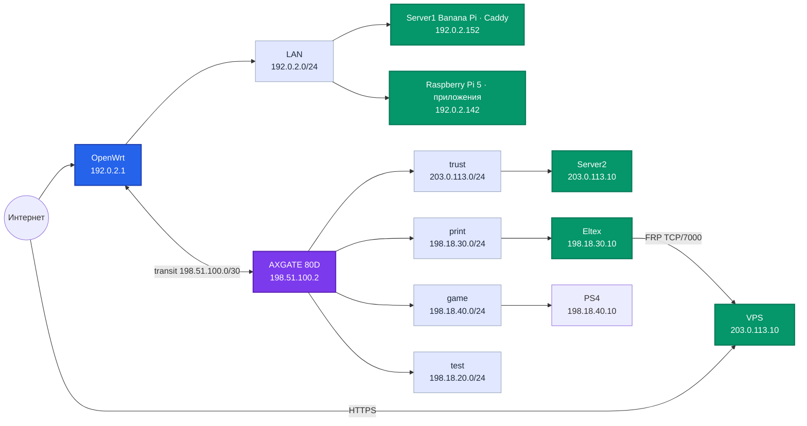
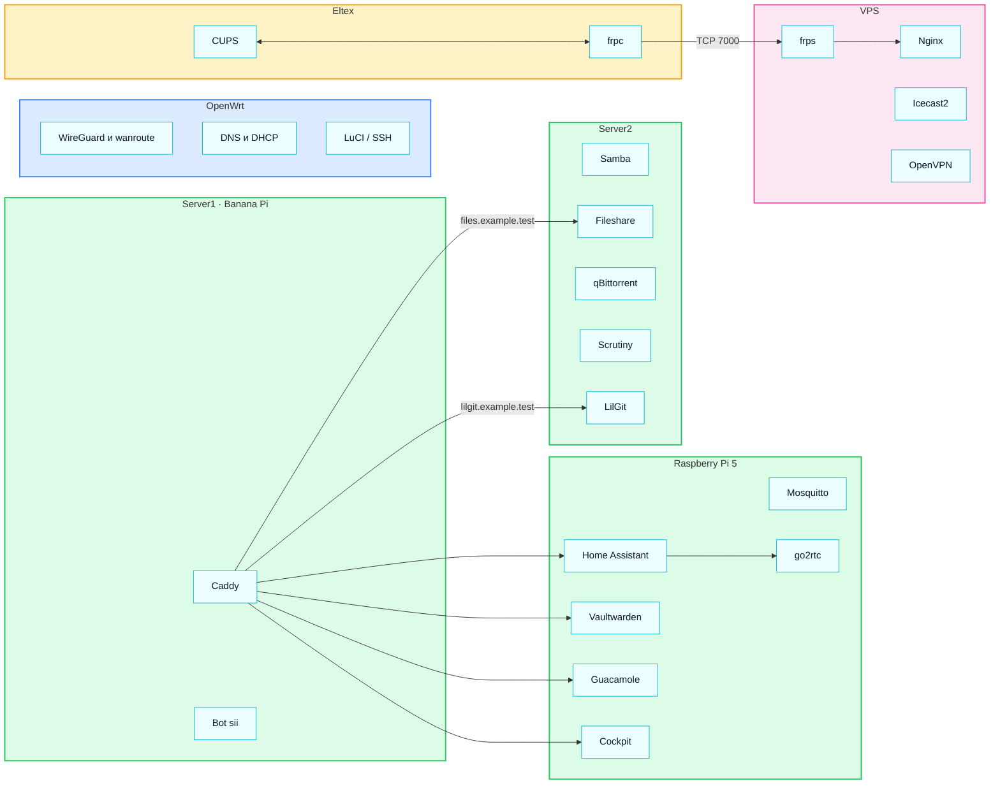

# Карта сети

Состояние на 26 октября 2026 года. [[OpenWrt]], [[Server1 Banana Pi]], [[Raspberry Pi 5]], [[Server2]], [[Eltex NV-501-WAC]] и [[VPS]] проверены по SSH; [[AXGATE 80D]] — через CLI. Пароли, ключи и токены здесь не хранятся.

## Устройства

[[OpenWrt]] · [[Server1 Banana Pi]] · [[Raspberry Pi 5]] · [[AXGATE 80D]] · [[Server2]] · [[Eltex NV-501-WAC]] · [[VPS]] · [[Сегменты сети]]

## Сводка узлов

| Узел | Роль | Что доступно на сетевом интерфейсе | Что остаётся локальным |
| --- | --- | --- | --- |
| [[OpenWrt]] | Основной роутер, WireGuard, DNS/DHCP | SSH, LuCI, DNS/DHCP; `ttyd` только на LAN | Системные службы управления маршрутами и firewall |
| [[Server1 Banana Pi]] | Внутренний веб-прокси | Caddy, SSH | DNS `*.example.test` указывает сюда; приложения перенесены на Raspberry Pi |
| [[Raspberry Pi 5]] | Приложения и панель управления | Home Assistant, Guacamole, Mosquitto, Vaultwarden, Cockpit, Telegram-бот, SSH | `liltorrent-bot.service` управляет LilTorrent на Server2; MariaDB и `guacd` внутри Docker; Caddy остаётся на Banana Pi |
| [[AXGATE 80D]] | Межсетевой экран и маршрутизатор сегментов | Панель `:17877`, CLI `:2323`, интерфейсы зон | Обработка политик и NAT внутри устройства |
| [[Server2]] | Файлы, загрузки, мониторинг дисков | SSH, Samba, Fileshare, qBittorrent, LilTorrent, Scrutiny | `liltorrent.service` слушает TCP `3000`; Docker/containerd и системные службы |
| [[Eltex NV-501-WAC]] | Принт-сервер | SSH и CUPS | FRP-клиент инициирует исходящий туннель к VPS |
| [[VPS]] | Публичный вход к печати и другие внешние сервисы | Nginx, FRP, Icecast2, OpenVPN, SSH | FRP-порт CUPS `127.0.0.1:18766`; Icecast `127.0.0.1:8000` |

«Слушает сетевой интерфейс» означает привязку сервиса к адресу узла. Доступ между сегментами определяется firewall, а выход в интернет — маршрутизацией и NAT. Для Server1 статических port forward на OpenWrt не найдено; публичная доступность его сервисов не подтверждена.

## Сервисы

[[WireGuard и wanroute]] · [[DNS и DHCP]] · [[SSH]] · [[Caddy]] · [[Home Assistant]] · [[go2rtc]] · [[Vaultwarden]] · [[Guacamole]] · [[Mosquitto]] · [[Cockpit]] · [[Bot sii]] · [[Samba]] · [[Fileshare]] · [[qBittorrent]] · [[Scrutiny]] · [[LilGit]] · [[CUPS]] · [[FRP]] · [[Nginx]] · [[Icecast2]] · [[OpenVPN]]

В Obsidian откройте папку `net` как хранилище. В Graph view цветовые группы удобно настроить запросами `path:servers`, `path:services` и `path:network`. Ссылки между файлами формируют граф, а диаграммы Mermaid показываются прямо в заметке.
