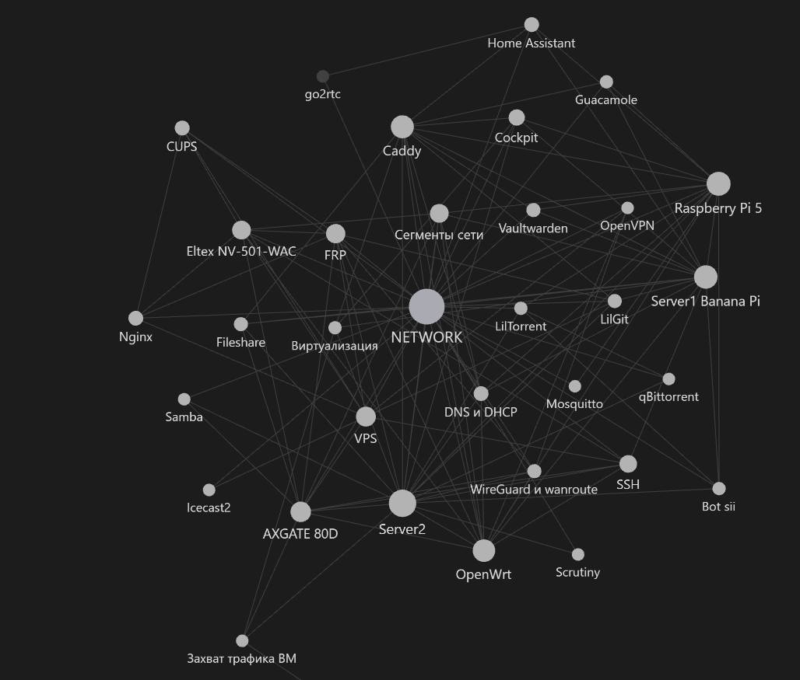

# Network Lab — portfolio edition

В репозитории показаны:

- сегментация сети и маршрутизация;
- Linux-серверы и ARM-устройства;
- reverse proxy и внутренние сервисы;
- виртуализация и избирательный захват трафика ВМ;
- примеры systemd- и Bash-автоматизации;
- эксплуатационные заметки и результаты проверок.

## Структура

- `NETWORK.md` — обзорная карта и документация сети;
- `servers/` — узлы инфраструктуры;
- `services/` — сервисы и способы их размещения;
- `network/` — сегменты и маршрутизация;
- `scripts/` — Bash-скрипты и systemd-unit.

## Граф связей

Визуализация связей между узлами и сервисами домашней лаборатории:

