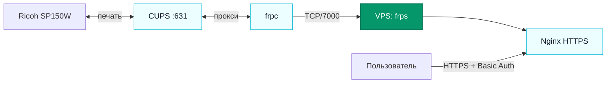

# Eltex NV-501-WAC

> [!info] Паспорт
> **Eltex NV-501-WAC · ARMv7 · около 738 МиБ ОЗУ · `198.18.30.10/24` · шлюз [[AXGATE 80D]] `198.18.30.1`.** Проверено по SSH 12 октября 2026 года.

[[NETWORK|Карта сети]] · [[Сегменты сети]]

Android/Linux использует ядро 3.10.24. SD-раздел `/dev/block/mmcblk1p1` размером около 28,5 ГБ смонтирован в `/mnt/linux`; на нём находится Ubuntu 22.04.5 LTS (`armhf`). Именно из этого chroot запускаются CUPS и FRP.

| Сервис | Где слушает / куда подключается | Назначение |
| --- | --- | --- |
| [[SSH]] | TCP `22`, все интерфейсы | Android `sshd`, вход по ключу; по описанию AXGATE доступ разрешён только ноутбуку `192.0.2.167`. |
| [[CUPS]] | TCP `631`, все интерфейсы | `cupsd` из Ubuntu chroot. Очереди `Ricoh_SP150W` и `Ricoh_SP150W_Mobile` включены и простаивают. |
| [[FRP]] | Исходящий TCP `7000` к [[VPS]] `203.0.113.10` | `frpc` из Ubuntu chroot регистрирует `eltex-cups`; входящий порт FRP на Eltex не нужен. |

Автозапуск `/data/local/start-printserver.sh` задаёт статический адрес, монтирует SD, запускает CUPS и FRP. После сбоя его исправили: он ждёт карту, очищает зависшие вложенные mount-точки и прерывает запуск при ошибке монтирования. Перезагрузка после исправления не проверялась. Часы Android в журнале FRP показывают даты 1970 года; эти временные метки ненадёжны.
