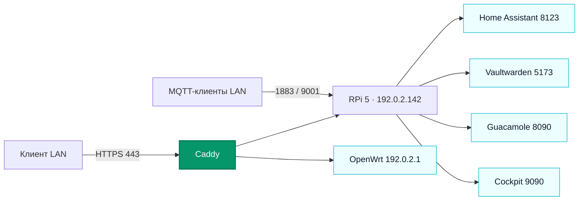

# Server1 · Banana Pi

> [!info] Паспорт
> **Bananapi BPI-M5** · Ubuntu 20.04.6 LTS · Linux `4.9.312-BPI-M5` · ARM64 · адрес `192.0.2.152/24` · шлюз [[OpenWrt]] `192.0.2.1`. Проверено по SSH 26 октября 2026 года.

[[NETWORK|Карта сети]] · [[Сегменты сети]]

## Оборудование и сеть

| Компонент | Состояние |
| --- | --- |
| Память | 3,6 ГиБ ОЗУ; swap выключен. |
| Система | `/` на ext4-разделе `mmcblk1p2` размером 116,1 ГБ; `/boot` на `mmcblk1p1` размером 256 МБ. |
| Встроенный накопитель | `mmcblk0` 14,6 ГБ обнаружен, в выводе `lsblk` разделы и точки монтирования не показаны. |
| Ethernet | `eth0` — `192.0.2.152/24`, адрес получен по DHCP. |
| Docker-сети | `172.19.0.0/16`, `172.20.0.0/16`, `172.23.0.0/16`; не являются отдельными физическими сетями. |

## Сервисы и границы доступа

«Слушает LAN» означает, что процесс привязан к сетевому интерфейсу Banana Pi. Это само по себе не доказывает доступность из интернета. В [[OpenWrt]] статические port forward к Server1 не обнаружены, UPnP выключен; внешний доступ через вышестоящий роутер не проверялся.

| Сервис | Где работает | Где слушает | Назначение |
| --- | --- | --- | --- |
| [[Caddy]] | systemd на хосте | TCP `80/443`, все интерфейсы | Внутренний HTTPS-прокси; приложения находятся на [[Raspberry Pi 5]]. |
| [[SSH]] | OpenSSH на хосте | TCP `22`, все интерфейсы | Административный вход. |
| [[Bot sii]] | Ранее `botsii.service` от пользователя `pi` | Служба перенесена на [[Raspberry Pi 5]] и остановлена на Server1 | Актуальная служба `liltorrent-bot.service` работает на Raspberry Pi. |

Работают также `smartmontools`, `cron`, `rsyslog`, `NetworkManager`, `systemd-networkd`, `systemd-resolved`, `systemd-timesyncd` и системные службы Ubuntu. Docker-приложения перенесены на [[Raspberry Pi 5]].

## Публикация через Caddy

| Имя | Куда направляет Caddy | Локальная проверка 26.10.2026 |
| --- | --- | --- |
| `ha.example.test` | `192.0.2.142:8123` → [[Home Assistant]] | HTTP `200` |
| `ssh.example.test` | `192.0.2.142:8090` → [[Guacamole]] | HTTP `200` |
| `router.example.test` | `192.0.2.1` → [[OpenWrt]] | DNS указывает на Server1; Caddy проксирует роутер, HTTP `200`. |
| `stat.example.test` | `https://192.0.2.142:9090` → [[Cockpit]] | HTTP `200` |
| `vaultwarden.example.test` | `192.0.2.142:5173` → [[Vaultwarden]] | HTTP `200` |
| `shell.example.test` | `192.0.2.142:8081` | HTTP `200` |
| `home.example.test` | `192.0.2.142:8082` | HTTP `200` |
| `files.example.test` | [[Fileshare]] `203.0.113.10:6574` | HTTP `200`; адрес обновлён 12 октября 2026 года. |
| `lilgit.example.test` | [[LilGit]] `203.0.113.10:8765` | HTTP `200`; адрес обновлён 12 октября 2026 года. |
| `vm.example.test` | [[Виртуализация]] / Cockpit Machines `https://203.0.113.10:9090` | HTTP `200`; добавлено 12 октября 2026 года. |

