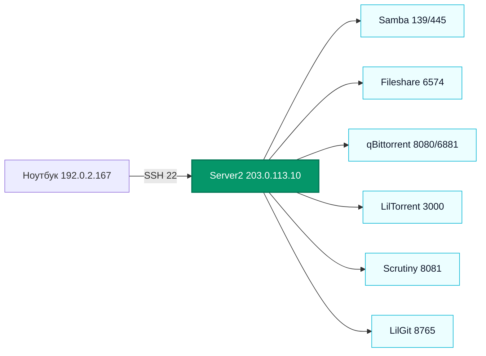

# Server2

> [!info] Паспорт
> **Xeon E3-1220 v2 · 15 ГиБ ОЗУ · Ubuntu 26.04 LTS · `203.0.113.10/24` · шлюз [[AXGATE 80D]] `203.0.113.1`.** Проверено по SSH 26 октября 2026 года.

[[NETWORK|Карта сети]] · [[Сегменты сети]]

## Оборудование и хранилище

| Устройство | Размер | Использование |
| --- | --- | --- |
| `sdb2` | 231,8 ГБ, ext4 | Система `/`; `sdb1` — EFI 1 ГБ. |
| `sdc2` | 1,8 ТБ, ext4 | `/mnt/lilgit-storage`. |
| `sdd1` | 3,6 ТБ, ext4 | `/mnt/disk1`; шары Samba и каталог HTTP-файлов. |
| `sde` | 931,5 ГБ, vfat | `/mnt/disk2`; шары Samba. |
| `sda1` | 465,8 ГБ, ext4, Samsung SSD 860 EVO | `/srv/vmstore`; пул libvirt `vmstore` для Arch, Debian и Windows 10. |

Основной интерфейс `enp5s0` имеет `203.0.113.10/24`; default route — `203.0.113.1`. Docker bridge — `172.18.0.1/16`.

Второй физический интерфейс `enp2s0` подключён к AXGATE `eth3` и входит в мост `br-vm-test` без IP-адреса на хосте. Виртуальная сеть libvirt `vm-test` использует этот мост и сегмент test `198.18.20.0/24`. Подробности — в [[Виртуализация]].

## Сервисы и границы доступа

«Слушает сеть» означает привязку к адресу Server2 или ко всем интерфейсам. Доступ из других сегментов определяется правилами [[AXGATE 80D]], а не только состоянием порта.

| Сервис | Где слушает | Назначение и состояние |
| --- | --- | --- |
| [[SSH]] / OpenSSH | TCP `22`, все интерфейсы | Администрирование; по описанию AXGATE допускает SSH только с `192.0.2.167`. |
| [[Samba]] | TCP `139/445`, все интерфейсы | Общие папки `Backup`, `Syst`, `media`; у всех гостевой доступ и запись. |
| [[Fileshare]] | TCP `6574`, все интерфейсы | Python HTTP-сервер файлов из `/mnt/disk1/file_server`; локально отвечает `200`. |
| [[qBittorrent]] | WebUI TCP `127.0.0.1:8080`; BitTorrent TCP/UDP `6881` | Клиент загрузок. WebUI локально отвечает `200`; также используется UDP `6771`, прямой WebUI наружу не опубликован. |
| [[LilTorrent]] | HTTP TCP `3000`, все интерфейсы | Веб-панель и API управления qBittorrent; systemd-служба `liltorrent.service`, HTTP локально отвечает `200`. |
| [[Scrutiny]] | TCP `8081`, все интерфейсы | Docker-контейнер мониторинга дисков; внутренний порт `8080`. |
| [[LilGit]] | TCP `8765`, `203.0.113.10` | Личный Git-сервер; служба включена, HTTP `200`. |
| [[Cockpit]] / Cockpit Machines | HTTPS TCP `9090`, все интерфейсы | Панель управления ВМ; доступ с ноутбука проверен, HTTP `200`. |
| [[Виртуализация]] / libvirt | Локальный сокет | Пул `vmstore` и сеть `vm-test` активны, автозапуск включён. |
| Docker/containerd | Локальные системные службы | Один активный контейнер `scrutiny`. |
| `smartmontools` | Локальная служба | SMART-мониторинг дисков. |
| Базовые службы | Локальные/служебные | `chrony`, `cron`, `rsyslog`, `systemd-networkd`, `systemd-resolved` и системные службы Ubuntu. |

Согласно правилам [[OpenWrt]], исходящий интернет-трафик подсети trust идёт через `wanroute`, мимо WireGuard. В AXGATE подтверждено наличие политик для trust, но конкретные условия сопоставления в CLI не считывались.

> [!note] Старый адрес
> `192.0.2.228` был прежним адресом Server2. LilGit перенастроен на `203.0.113.10:8765`, а [[Caddy]] направляет `lilgit.example.test` на этот адрес.

