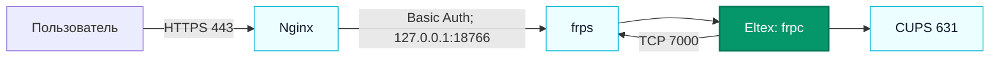

# VPS

> [!info] Паспорт
> **`203.0.113.10` · Ubuntu 20.04.6 LTS · `8473.landvps.online` · 588 МиБ ОЗУ · системный диск 10 ГБ.** Проверено по SSH 12 октября 2026 года.

[[NETWORK|Карта сети]]

Система установлена на ext4-разделе `/dev/vda2`. При проверке корневая файловая система была занята на 70% (`6,5` из `9,8` ГБ доступного объёма).

## Сервисы и границы доступа

| Сервис | Где слушает | Назначение и состояние |
| --- | --- | --- |
| [[Nginx]] | TCP `80/443`, все интерфейсы | Публичный HTTPS-сайт `greatprint.duckdns.org`, Basic Auth и прокси к локальному FRP-порту. |
| [[FRP]] / `frps` | TCP `7000`, все интерфейсы; TCP `18766` **только `127.0.0.1`** | Принимает клиента [[Eltex NV-501-WAC]] и передаёт запросы к CUPS. |
| [[Icecast2]] | TCP `8443`, все интерфейсы; TCP `8000` **только `127.0.0.1`** | Аудиосервер; потоки и клиенты не проверялись. |
| [[OpenVPN]] | UDP `1194`, все интерфейсы | `openvpn@server` активен; клиенты и маршруты не проверялись. |
| [[SSH]] | TCP `22` и `654`, все интерфейсы | Административный доступ. |
| Базовые службы | Локальные/служебные | `cron`, `rsyslog`, `systemd-networkd`, `systemd-resolved`, `systemd-timesyncd` и службы Ubuntu. |

Локальный URL через FRP возвращает HTTP `200`. Публичный `https://greatprint.duckdns.org/printers/Ricoh_SP150W` без учётных данных возвращает `401`: HTTP Basic Auth включена. Сертификат Let's Encrypt присутствует.

Параметры клиентов [[Icecast2]] и [[OpenVPN]] не проверялись; здесь зафиксированы наблюдаемые службы и порты.
