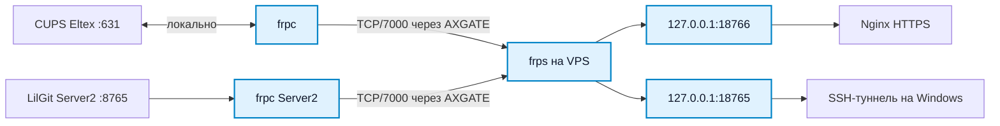

# FRP

FRP обслуживает [[CUPS]] и [[LilGit]] через [[VPS]]. На Eltex работает `frpc` с прокси `eltex-cups`; на [[Server2]] работает отдельный `frpc` с прокси `lilgit-private-full`. Оба клиента подключаются к `203.0.113.10:7000`. На VPS `frps` предоставляет локальные порты `127.0.0.1:18766` для CUPS и `127.0.0.1:18765` для LilGit. [[Nginx]] обращается к порту CUPS; LilGit доступен через SSH-туннель к VPS. [[NETWORK|Карта сети]]

По описанию [[AXGATE 80D]] разрешает print-сегменту только это соединение и выполняет SNAT в `198.51.100.2`; [[OpenWrt]] отправляет его через `wanroute`. При проверке FRP-соединение было установлено, запрос к локальному порту VPS вернул HTTP `200`.
